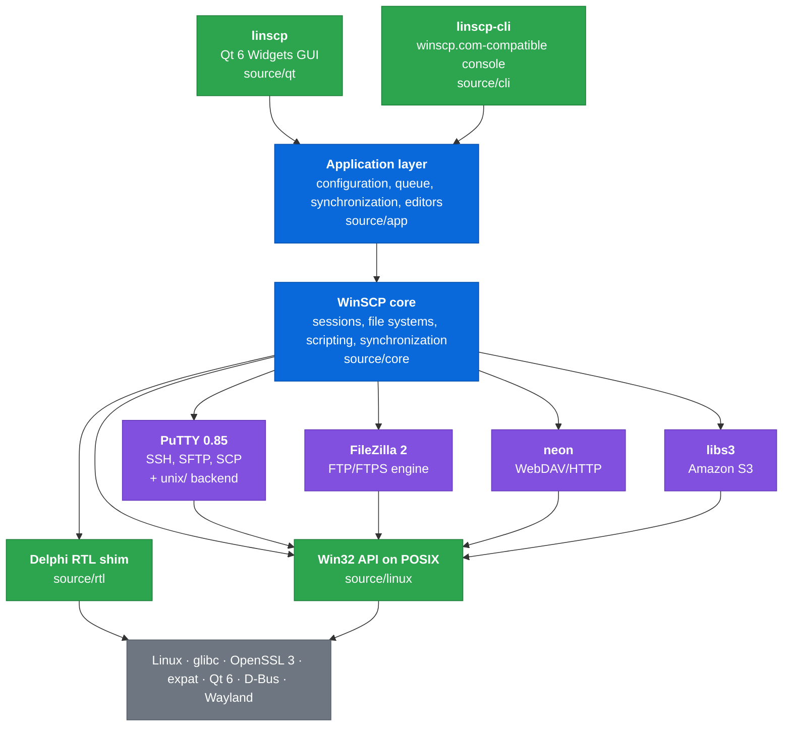
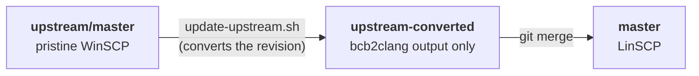

# How the port works

This document describes how LinSCP turns WinSCP's C++Builder sources into a native Linux
application. The project overview is in the [README](../readme.md). The plan, the decisions and
the progress log are in [`docs/port`](port/).

WinSCP is written in Embarcadero C++Builder. It uses a C++ dialect with Delphi extensions
(`__property`, `__closure`, `try`/`__finally`), the Delphi RTL and VCL, and the Win32 API. No
other compiler builds it as it is. A rewrite would lose years of protocol fixes, and Wine would
not give a native Wayland application. LinSCP therefore **keeps all non-visual code and
replaces only what lies below and above it.**



<sub>🟩 new code written for LinSCP · 🟦 upstream code, mechanically converted · 🟪 upstream
third-party code, built with a Linux backend · ⬜ system libraries</sub>

| Upstream part | Size | What happened to it |
|---|---|---|
| `source/core`: sessions, protocols, queue, scripting | ~76k lines | Converted by `bcb2clang`, compiled against the RTL shim |
| `source/putty`: PuTTY 0.85 with WinSCP changes | ~83k lines | Shared code unchanged. A `unix/` backend, derived from PuTTY 0.85's with WinSCP's changes, replaces `windows/` |
| `source/filezilla`: FileZilla 2 FTP engine | ~19k lines | Its Windows event model runs as it is, on emulated window messages and `WSAAsyncSelect` |
| `libs/neon`, `libs/libs3` | | In-tree (WinSCP-modified) sources, built against the system OpenSSL and expat |
| `source/windows`: GUI glue (configuration, console runner, controllers) | ~29k lines | Portable parts ported (`source/app`, `source/cli`), the rest rewritten in Qt |
| `source/forms`: 48 VCL forms | ~47k lines | Rewritten in Qt 6. The `.dfm` files are the specification |
| `source/components`, `source/packages`, `source/dragext`, `dotnet`, `deployment` | | Not built. Kept unchanged as reference |

## 1. Clang takes the place of C++Builder

Clang supports Microsoft's `__declspec(property(get=…, put=…))`, including indexed properties,
with `-fdeclspec`. Only the property **declarations** need to change. The thousands of places
that *use* properties (`Terminal->SessionData->HostName = …`) compile as they are. The project
uses C++17, the dialect of the upstream core. With C++20, the core's mixed-type comparisons
become ambiguous.

## 2. `bcb2clang`: a reproducible source conversion

[`tools/bcb2clang`](../tools/bcb2clang) is a Python converter with a tokenizer and bracket
matching. It rewrites the C++Builder dialect into standard C++ that Clang accepts. It never
moves code to another line, so diffs between converted upstream revisions stay small:

```cpp
// C++Builder (upstream)
__property UnicodeString HostName = { read=FHostName, write=SetHostName };

typedef void __fastcall (__closure *TQueryUserEvent)
  (TObject * Sender, const UnicodeString Query, /* ... */ void * Arg);

try { /* ... */ } __finally { delete FSecureShell; FSecureShell = NULL; }
```

```cpp
// Clang (converted)
UnicodeString & __property_get_HostName() const { return ::rtl::Mutable(this)->FHostName; }
void __property_set_HostName(UnicodeString Value) { SetHostName(Value); }
__declspec(property(get = __property_get_HostName, put = __property_set_HostName)) UnicodeString HostName;

typedef TMethodPtr<void(TObject * Sender, const UnicodeString Query, /* ... */ void * Arg)>
 TQueryUserEvent;

{ ::rtl::TFinally Finally([&]() { delete FSecureShell; FSecureShell = NULL; }); try { /* ... */ } }
```

The converter also turns method references into delegates (`OnX = Method` →
`::rtl::MethodPtr(this, &TClass::Method)`), resolved with a table of the classes in all core
files. It also reproduces C++Builder semantics where they differ from standard C++:
inheritance from Delphi classes is always public, enumerations are `int`-sized, and `long` is
32-bit (Windows is LLP64, and SFTP packet code depends on it).

## 3. A Delphi RTL in standard C++

[`source/rtl`](../source/rtl) implements the parts of the Delphi RTL that the core uses, under the
original header names (`System.hpp`, `Classes.hpp`, `SysUtils.hpp`, …):

- `UnicodeString` with 1-based indexing, built on 32-bit `wchar_t`, so `L"…"` literals work as
  they are. UTF-8 is used only at the file system and network boundaries. Invalid bytes in
  file names map reversibly to lone surrogates (like Python's `surrogateescape`), so non-UTF-8
  names survive a round trip.
- `TObject`, `TStrings`/`TStringList`, streams, `TDateTime` and time zones, `Format` with Delphi
  rounding, `TMemIniFile`, threads and synchronization, a read-only XML DOM on expat.
- Delphi object semantics: objects and thrown exceptions are zero-filled
  (`--wrap=__cxa_allocate_exception`), as the core assumes. OS errors are reported as Windows
  error codes, which the core compares against.

## 4. Win32 on POSIX

[`source/linux`](../source/linux) implements the Windows API that the upstream code calls,
behind the real SDK header names:

| Windows | Linux |
|---|---|
| `HANDLE`, files, `FindFirstFile` | file descriptors and POSIX file calls |
| events, threads, `WaitForMultipleObjects` | `eventfd`, `std::thread`, `poll()` |
| window messages, timers, `WSAAsyncSelect` (FileZilla engine) | per-thread message queues on `eventfd`, polled together with the sockets, with Windows semantics (one event until it is re-enabled, `FD_CLOSE` after the data) |
| `WSAEventSelect` (PuTTY) | PuTTY's `uxsel` descriptors + `poll()` |
| CryptoAPI certificate chains | OpenSSL with the system CA store |
| Registry | `~/.config/linscp/linscp.ini` (WinSCP's INI storage) |
| Pageant | `ssh-agent` (`SSH_AUTH_SOCK`) |
| `%APPDATA%`, special folders | XDG base directories |

## 5. A Qt GUI that follows the `.dfm` files

The GUI in [`source/qt`](../source/qt) is new code. WinSCP's form files define it:

- **Object names are the VCL component names** (`LoginDialog/SessionTree`,
  `CopyDialog/OkButton`). This keeps WinSCP's translations (`translations/*.ini`, keyed by
  form and component) working without changes, and gives the tests stable names.
- Build-time generators read the upstream sources: `rc2cpp` turns WinSCP's string resources
  into C++ tables, and `dfm2cpp` turns the English texts of the forms into the source texts of
  a `QTranslator`.
- The threading model is WinSCP's. Terminal operations run synchronously on the GUI thread and
  pump the Qt event loop, and the transfer queue runs on its own threads.
- The icons are LinSCP's own, drawn in WinSCP's style by
  [`tools/icons/make_icons.py`](../tools/icons/make_icons.py). WinSCP's icon set is not free to
  reuse ([`license.txt`](../license.txt), part B).

**Drag and drop on Wayland.** Wayland has no `XdndDirectSave`, so a file manager cannot tell
the application where a dragged remote file should go. LinSCP has two modes, like WinSCP:

1. **KDE mode.** Drags use Ark's extraction protocol. Dolphin calls back over D-Bus with the
   drop directory, and the files download straight there.
2. **Universal mode.** Files download to a temporary directory only when the target asks for
   the data.

## 6. Following upstream

LinSCP keeps merging new WinSCP releases. Pristine upstream is never merged directly:



Each commit on `upstream-converted` is exactly the converter's output for one upstream
revision. Merging it into `master` applies *convert(new) − convert(old)*, so conflicts appear
only where LinSCP's few manual edits meet upstream changes. Those edits are marked with
`LinSCP:` comments. New code lives in new directories, and the Windows-only upstream
directories stay unchanged. See [`docs/port/UPSTREAM.md`](port/UPSTREAM.md).

## Testing

| Layer | Tools | What it checks |
|---|---|---|
| **L1** unit | GoogleTest, ASan + UBSan | RTL semantics against Delphi (indexes, `Format`, dates), core logic (masks, listings, URLs) |
| **L2** protocols | `linscp-cli` + local `sshd` + test VM | Transfers, resume, synchronization, permissions, host keys and authentication on SFTP, SCP, FTP (vsftpd, ProFTPD, Pure-FTPd), FTPS, WebDAV (Apache, nginx) and S3 |
| **L3** components | Qt Test, offscreen platform | Dialogs and models |
| **L4** end-to-end | Headless KWin harness | Full scenarios in a real compositor: real input, drag and drop with Dolphin, the clipboard, notifications and the tray against fake desktop services |
| **Smoke** | Release build, offscreen | The optimized build starts, connects and keeps running |

The harness ([`tools/wlharness`](../tools/wlharness)) starts `kwin_wayland --virtual` in a user and
mount namespace with its own D-Bus session and system bus, `HOME` and pinned Breeze theme.
`wlh-input` injects real compositor input through `org_kde_kwin_fake_input` (Wayland drags
need the serial of a real pointer event). Other applications, such as Dolphin, are driven over
AT-SPI.
