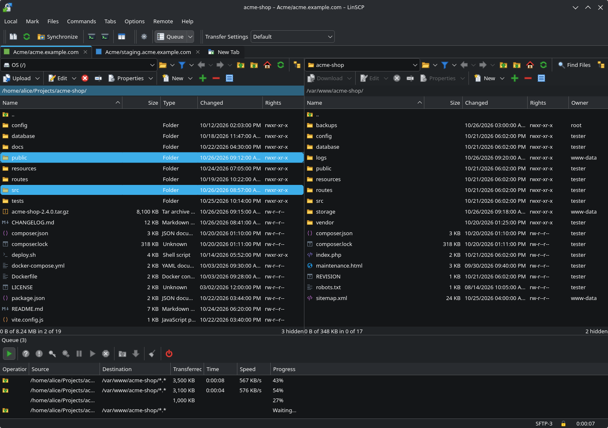
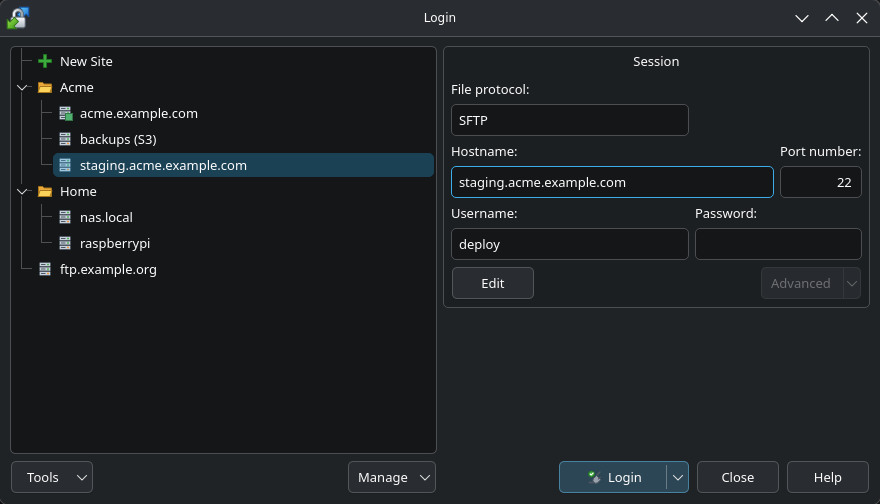
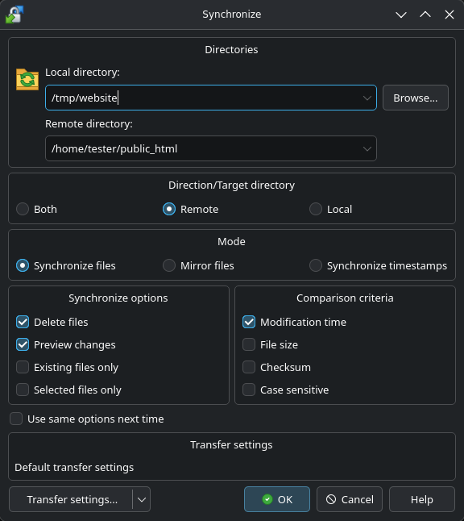
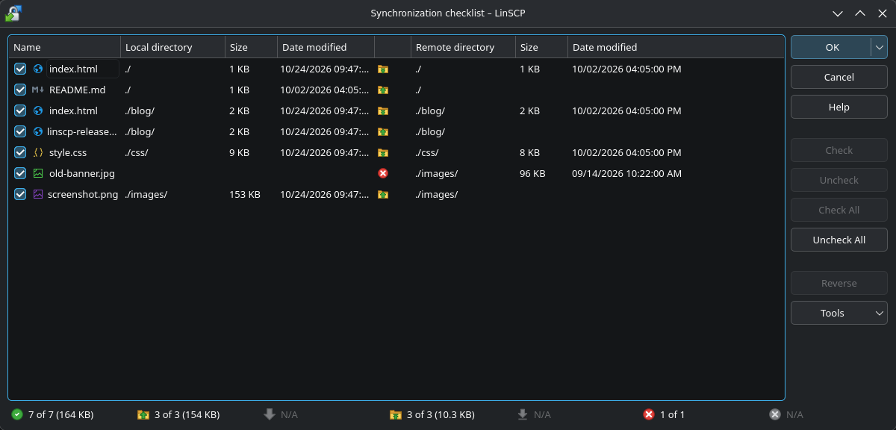
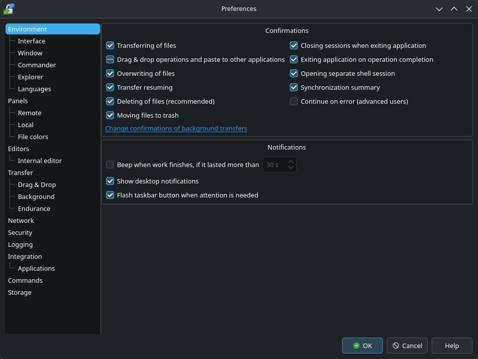
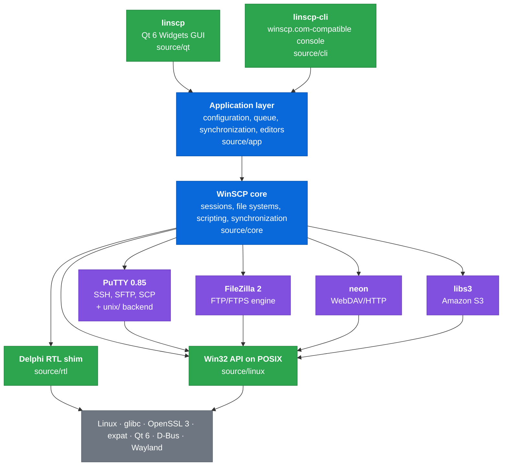

<div align="center">


# LinSCP

**WinSCP, natively on Linux.**

An SFTP, SCP, FTP/FTPS, WebDAV and S3 client with a two-panel file manager, built for Wayland
from WinSCP's own protocol core. It is a port, not a rewrite.

[](license.txt)
[](#building)
[](https://www.qt.io/)
[](#building)
[](https://winscp.net/)
[](docs/ARCHITECTURE.md#testing)

[Screenshots](#screenshots) ·
[Features](#features) ·
[Install](#installation) ·
[Build](#building) ·
[How the port works](#how-the-port-works) ·
[Security](#security)

<br>



</div>

> [!NOTE]
> LinSCP is an independent, unofficial port. It is not affiliated with or endorsed by WinSCP or
> its author, Martin Přikryl. Please report problems with LinSCP here, not to the WinSCP
> project.

> [!IMPORTANT]
> **Same engine as WinSCP.** Connections, credentials and transfers are handled by WinSCP's
> own code (the WinSCP core, PuTTY, the FileZilla FTP engine, neon and libs3), compiled for
> Linux. LinSCP implements no protocol or cryptography of its own, and WinSCP's security fixes
> are merged as they are released. See [Security](#security).

## Why LinSCP?

- **The real WinSCP engine.** About 180,000 lines of WinSCP's non-visual code (the session
  core, PuTTY, the FileZilla FTP engine, neon, libs3) are compiled for Linux, with only the
  edits that Linux requires.
  More than twenty years of fixes for server quirks come with them.
- **A native UI with the WinSCP layout.** The GUI is written from scratch in Qt 6 Widgets. Each
  window follows the matching WinSCP form (`.dfm`): the same controls, menus, shortcuts and
  behaviour.
- **Made for Wayland.** Drag and drop works both ways with Dolphin and other file managers.
  The file clipboard, `sftp://` links, notifications, the tray, task manager progress and XDG
  activation work too. There is no X11 or Wine layer.
- **Compatible.** The configuration uses the `WinSCP.ini` format. `linscp-cli` runs the
  `winscp.com` scripting language. WinSCP's own translations work without changes.
- **Follows upstream.** New WinSCP releases are merged through a reproducible conversion
  ([how](docs/ARCHITECTURE.md#6-following-upstream)), so security and protocol fixes reach LinSCP too.

## Screenshots

<table>
  <tr>
    <td width="66%"></td>
    <td width="34%"></td>
  </tr>
  <tr>
    <td align="center"><b>Site manager</b>: sites in folders, any protocol</td>
    <td align="center"><b>Synchronize</b>: direction, mode and criteria</td>
  </tr>
  <tr>
    <td colspan="2"></td>
  </tr>
  <tr>
    <td colspan="2" align="center"><b>Synchronization checklist</b>: review every upload, download and delete before it runs</td>
  </tr>
  <tr>
    <td colspan="2" align="center"></td>
  </tr>
  <tr>
    <td colspan="2" align="center"><b>Preferences</b>: WinSCP's options, page by page</td>
  </tr>
</table>

## Features

| | |
|---|---|
| **Protocols** | SFTP, SCP, FTP, FTPS (explicit and implicit), WebDAV, WebDAVS, Amazon S3 and S3-compatible storage |
| **Interfaces** | *Commander* (local and remote panels) and *Explorer* (remote only), tabs, workspaces, directory trees |
| **Transfers** | Background queue with parallel connections, resume, transfer settings with presets and rules, file masks, drag and drop |
| **Synchronization** | Two-way, mirror and timestamp synchronization with a preview checklist, *Keep remote directory up to date* (inotify), *Compare directories*, synchronized browsing |
| **Editing** | Built-in editor; external editors with automatic upload on save |
| **Authentication** | Password, keyboard-interactive, public keys (PuTTY `.ppk` and OpenSSH keys), `ssh-agent`, host key and TLS certificate verification, trusted SSH host CAs, master password |
| **Desktop** | Drag and drop to Dolphin/KIO without temporary copies, file clipboard (copy, cut, paste), URL handlers (`sftp`, `scp`, `ftp`, `ftps`, `ftpes`, `dav`, `davs`, `s3`), single instance over D-Bus, notifications, tray icon, sleep or shut down when the queue is done |
| **Tools** | Find files, properties and `chmod`, checksums, links, console, custom commands, *Open in SSH client* (OpenSSH or PuTTY), generating session URLs and code |
| **Scripting** | `linscp-cli`: the `winscp.com` scripting language, command-line switches, exit codes and XML log |
| **Import** | Sites from PuTTY, FileZilla, OpenSSH `~/.ssh/config`, `known_hosts` and `WinSCP.ini` |
| **Languages** | All WinSCP translations, including right-to-left languages |

## Installation

Every [release](https://github.com/mikigal/LinSCP/releases) comes with packages for x86_64:

| System | File |
|---|---|
| Debian 13 | `linscp_<version>_debian13_amd64.deb` |
| Ubuntu 26.04, 26.10 | `linscp_<version>_ubuntu26.04_amd64.deb`, `linscp_<version>_ubuntu26.10_amd64.deb` |
| Fedora 43, 44 | `linscp-<version>.fc43.x86_64.rpm`, `linscp-<version>.fc44.x86_64.rpm` |
| openSUSE Tumbleweed, Leap 16.0 | `linscp-<version>.tumbleweed.x86_64.rpm`, `linscp-<version>.leap16.0.x86_64.rpm` |
| Other distributions (glibc 2.39 or later, e.g. Ubuntu 24.04) | `LinSCP-<version>-x86_64.AppImage`, or the same files in `linscp-<version>-x86_64.tar.gz` |
| Arch Linux | `linscp-<version>-<release>-x86_64.pkg.tar.zst` for `pacman -U`, the AUR's `linscp` (built from source) or `linscp-bin` (that package; both not published yet), or the PKGBUILD below |

Install a package with the system's package manager, which also installs its dependencies.
The packages are not signed: check them against `SHA256SUMS` of the release.

```bash
sudo apt install ./linscp_<version>_debian13_amd64.deb
sudo dnf install ./linscp-<version>.fc44.x86_64.rpm
sudo zypper install --allow-unsigned-rpm ./linscp-<version>.tumbleweed.x86_64.rpm
sudo pacman -U ./linscp-<version>-<release>-x86_64.pkg.tar.zst
```

The AppImage and the tarball include Qt but use the system's OpenSSL. To use `linscp-cli`
from the AppImage, run it through a link named `linscp-cli`
(`ln -s LinSCP-<version>-x86_64.AppImage linscp-cli`). The tarball has `linscp` and
`linscp-cli` at its top.

### Arch Linux

> [!NOTE]
> LinSCP is not in the AUR yet. Registration of new AUR accounts is currently disabled, so
> the `linscp` and `linscp-bin` packages ([`packaging/aur`](packaging/aur)) cannot be
> published for now. Until then, install the release's package with `pacman -U`, or build
> the PKGBUILD below.

The repository includes a PKGBUILD that builds the checkout it is in:

```bash
git clone https://github.com/mikigal/LinSCP.git
cd LinSCP/packaging/arch
makepkg -si
```

This installs `linscp`, `linscp-cli`, the desktop entry, the icon, the translations and the
license.

### Other distributions

Use the AppImage, or follow [Building](#building), then run `cmake --install` (see below).
Arch Linux with KDE Plasma is the reference platform. Other distributions and desktops
(GNOME, wlroots) are supported but tested less.

## Building

LinSCP builds **only with Clang**. The ported core uses Clang's
`__declspec(property)` extension (`-fdeclspec`) to keep C++Builder property syntax working
([details](#how-the-port-works)). CMake stops with an error if it finds another compiler.

### Requirements

| | Version | Arch Linux | Debian / Ubuntu | Fedora |
|---|---|---|---|---|
| Clang | C and C++17 (developed with Clang 23) | `clang` | `clang` | `clang` |
| CMake | ≥ 3.28 | `cmake` | `cmake` | `cmake` |
| Ninja | | `ninja` | `ninja-build` | `ninja-build` |
| Python | ≥ 3.11 | `python` | `python3` | `python3` |
| OpenSSL | ≥ 3 | `openssl` | `libssl-dev` | `openssl-devel` |
| expat | ≥ 2.5 | `expat` | `libexpat1-dev` | `expat-devel` |
| Qt | ≥ 6.5: Widgets, DBus, SVG | `qt6-base` `qt6-svg` | `qt6-base-dev` `qt6-svg-dev` | `qt6-qtbase-devel` `qt6-qtsvg-devel` |

Optional at runtime: `openssh` or `putty` (*Open in SSH client*), `xdg-utils` (default URL
handler), `libcanberra` (sound when an operation finishes), `qt6-translations`.

<details>
<summary>One-line install commands</summary>

```bash
# Arch Linux
sudo pacman -S --needed clang cmake ninja python openssl expat qt6-base qt6-svg
```

```bash
# Debian 13 / Ubuntu 25.04 or later (Ubuntu 24.04 has Qt 6.4, which is too old)
sudo apt install clang cmake ninja-build python3 libssl-dev libexpat1-dev qt6-base-dev qt6-svg-dev
```

```bash
# Fedora
sudo dnf install clang cmake ninja-build python3 openssl-devel expat-devel qt6-qtbase-devel qt6-qtsvg-devel
```

Package names for Debian, Ubuntu and Fedora are a starting point. Only Arch Linux is
built and tested regularly.

</details>

### Release build

```bash
git clone https://github.com/mikigal/LinSCP.git
cd LinSCP
cmake --preset release
cmake --build --preset release
```

The binaries are `build/release/source/qt/linscp` (the GUI) and
`build/release/source/cli/linscp-cli`. To install them system-wide:

```bash
sudo cmake --install build/release --prefix /usr/local
```

### Build options

| CMake option | Default | Meaning |
|---|---|---|
| `LINSCP_BUILD_TESTS` | `ON` | Unit and integration tests (needs GoogleTest ≥ 1.14 and Qt Test) |
| `LINSCP_BUILD_HARNESS` | `ON` | The Wayland test harness tools (need `wayland-client`, `xkbcommon` and `plasma-wayland-protocols`) |
| `LINSCP_SANITIZE` | `OFF` | AddressSanitizer and UndefinedBehaviorSanitizer |
| `LINSCP_AUTOMATION` | `OFF` | **Test builds only.** Adds the GUI automation socket used by the end-to-end tests. Never enable it in a build that others will use ([why](SECURITY.md#automation-hook)). |
| `LINSCP_RELEASE_BUILD` | `OFF` | A build for distribution: the version is not marked as a development build |

The `release` preset turns off tests, the harness, sanitizers and the automation hook. A
distribution package should also set `-DLINSCP_RELEASE_BUILD=ON`, as the
[PKGBUILD](packaging/arch/PKGBUILD) does.

### Development build and tests

```bash
cmake --preset dev               # Debug + ASan/UBSan + tests + harness + automation hook
cmake --build --preset dev
ctest --preset dev               # everything
ctest --preset unit              # unit tests only
ctest --preset dev -L gui        # labels: unit, integration, ssh, gui, smoke, vm
```

The GUI tests run in a private headless KWin session and never open windows on your desktop.
They need KDE Plasma's `kwin_wayland` and `spectacle`, `dbus-daemon`, and unprivileged user
namespaces (`unshare --user`). The protocol tests start their own unprivileged `sshd` on `127.0.0.1`. The
FTP, WebDAV and S3 tests need a test VM, provisioned by
[`tools/testenv/vm/provision.sh`](tools/testenv/vm/provision.sh), and are skipped without it.

### Releases

Publishing a GitHub release starts [`release.yml`](.github/workflows/release.yml). It builds
the packages listed in [Installation](#installation) and the source tarball in containers of
the distributions (the AppImage on Ubuntu 24.04 with Qt from `aqtinstall`), installs and
checks each package, adds them and `SHA256SUMS` to the release, and publishes the release in
the AUR as `linscp` (built from the source tarball) and `linscp-bin` (the release's package of
Arch Linux). The scripts are in [`packaging/ci`](packaging/ci).

- The tag is `v` and LinSCP's version, `project(LinSCP VERSION ...)` in `CMakeLists.txt`
  (set it in a commit before tagging): `X.Y.Z`, the version of the core (`FileVersion` in
  `source/WinSCP.cbproj`), for the first release on that core, `X.Y.Z.N` (`N` from 1) for
  further releases of LinSCP on it. `vX.Y.Z[.N]-R` releases new packages of the same
  version (`R` is the release of the packages, 1 otherwise). The workflow stops on any
  other tag.
- Run by hand (*Actions → Release → Run workflow*) with a tag, it builds that release again
  and replaces its files. Without a tag, it only builds, and the files stay with the run.
- The AUR needs the repository secret `AUR_SSH_PRIVATE_KEY`, the private SSH key of the AUR
  account that maintains `linscp` and `linscp-bin`. Without it, the workflow skips the AUR
  with a notice.
  Pre-releases are not published in the AUR.

## Usage

```bash
linscp                                    # site manager
linscp sftp://user@example.com/var/www/   # open a session directly
linscp sftp://user@example.com/incoming/ /upload file1 file2
```

```bash
# Scripting, compatible with winscp.com
linscp-cli /log=session.log /command \
    "open sftp://user@example.com/ -hostkey=\"ssh-ed25519 255 SHA256:...\"" \
    "synchronize remote ./site /var/www" \
    "exit"
```

The configuration is stored in `~/.config/linscp/linscp.ini` (or `$XDG_CONFIG_HOME`), in the
`WinSCP.ini` format. To bring sites over from Windows, use **Site Manager → Tools → Import
Sites** with your `WinSCP.ini`. WinSCP's
[documentation](https://winscp.net/eng/docs/start) applies to LinSCP, and the Help buttons open
the matching pages.

## How the port works

WinSCP is written in Embarcadero C++Builder. It uses a C++ dialect with Delphi extensions
(`__property`, `__closure`, `try`/`__finally`), the Delphi RTL and VCL, and the Win32 API. No
other compiler builds it as it is. A rewrite would lose years of protocol fixes, and Wine would
not give a native Wayland application. LinSCP therefore **keeps all non-visual code and
replaces only what lies below and above it.**



<sub>🟩 new code written for LinSCP · 🟦 upstream code, mechanically converted · 🟪 upstream
third-party code, built with a Linux backend · ⬜ system libraries</sub>

In short:

- **Clang takes the place of C++Builder.** Its `__declspec(property)` support keeps the
  thousands of places that use C++Builder properties unchanged.
- **[`bcb2clang`](tools/bcb2clang)** converts the C++Builder dialect (`__property`,
  `__closure`, `try`/`__finally`) into standard C++. The conversion is reproducible and keeps
  every line where it was.
- **[`source/rtl`](source/rtl)** implements the parts of the Delphi RTL that the core uses,
  and **[`source/linux`](source/linux)** implements the Win32 API on POSIX.
- **The GUI is new Qt 6 code** that follows WinSCP's `.dfm` forms, so WinSCP's translations
  work without changes.
- **New WinSCP releases are merged** through a branch of converted upstream code. Conflicts
  appear only where LinSCP edited upstream code.

The full technical description, with code examples and the test setup, is in
**[docs/ARCHITECTURE.md](docs/ARCHITECTURE.md)**.

## Security

> [!IMPORTANT]
> **The engine is WinSCP's, not a reimplementation.** Everything that handles your
> connections, credentials and data is WinSCP's own code, compiled for Linux: the WinSCP core,
> PuTTY's SSH implementation, the FileZilla FTP engine, neon (WebDAV) and libs3 (S3). LinSCP
> does not write any protocol or cryptography of its own. Edits to this code are limited to
> what Linux requires. They are marked with `LinSCP:` comments and listed in
> [`docs/port/PROGRESS.md`](docs/port/PROGRESS.md). WinSCP's security fixes reach LinSCP
> through the regular upstream merges. The one difference is that TLS uses the system's
> OpenSSL 3 instead of WinSCP's bundled copy, so it gets your distribution's updates.

LinSCP keeps WinSCP's security model: host keys and certificates are verified the same way,
and stored passwords can be encrypted with a master password. The port adds its own measures:

- **No phoning home.** LinSCP has no update checks and no usage statistics (WinSCP's code for
  them was not ported). It connects only to the servers you open. Help pages open in your
  browser only when you ask for them.
- **TLS certificates** (FTPS, WebDAVS, S3) are verified against the system CA store through
  OpenSSL. **SSH host keys** are confirmed on first use and cached, as in WinSCP.
- **Path traversal protection is kept.** A server cannot make LinSCP write outside the target
  directory: `/` in remote names is encoded or refused, and `.` and `..` from SCP are refused.
  The rules were adapted to Linux file names without weakening them.
- **Private local files.** The configuration (`~/.config/linscp`, 0700 and 0600) and the
  temporary copies of remote files (`$TMPDIR/linscp-UID`, 0700) are accessible to you only.
  WinSCP relies on Windows' per-user folders for this, but `/tmp` is shared on Linux.
- **No test hooks in release builds.** The GUI automation socket exists only with the
  `LINSCP_AUTOMATION` compile option, which the release preset and the package turn off.
- **Sanitized test suite.** The tests run under AddressSanitizer and
  UndefinedBehaviorSanitizer. They never touch your `~/.ssh`, SSH agent, configuration or
  desktop session.

> [!TIP]
> Without a master password, saved passwords are only obfuscated, as in WinSCP. Set one in
> **Preferences → Security**, or use keys with `ssh-agent` and do not save passwords.

To report a vulnerability, see [SECURITY.md](SECURITY.md). Please do not open a public issue.

## Repository layout

```text
source/rtl          Delphi RTL shim (linscp::rtl)
source/linux        Win32 API on POSIX for the upstream code
source/core         WinSCP core, converted by bcb2clang       (upstream)
source/putty        PuTTY 0.85 + unix/ backend                (upstream)
source/filezilla    FileZilla 2 FTP engine                    (upstream)
source/lib*         build definitions of the upstream libraries
source/app          application layer shared by the front ends
source/cli          linscp-cli
source/qt           linscp, the Qt 6 GUI (app/, dialogs/, models/, views/)
tools/bcb2clang     C++Builder → Clang converter and upstream update script
tools/rc2cpp        string resources → C++ tables
tools/dfm2cpp       .dfm form texts → translation sources
tools/icons         generator of LinSCP's icon set
tools/wlharness     headless KWin test harness
tools/testenv       local sshd, test VM provisioning, GUI and CLI drivers
tests/              unit (L1, L3) and integration (L2, L4) tests
docs/port/          plan, progress log and upstream workflow
packaging/          packages: Arch, AUR, Debian, RPM, AppImage; scripts of the release
.github/workflows   release workflow
```

The Windows-only upstream directories (`source/forms`, `source/windows`, `source/components`,
`source/packages`, `source/dragext`, `dotnet`, `deployment`) are not built. They stay
unchanged as the reference for the port.

## Contributing

Read [`docs/port/PLAN.md`](docs/port/PLAN.md) (architecture and decisions) and
[`docs/port/PROGRESS.md`](docs/port/PROGRESS.md) (current state) first. In short:

- Everything in the repository is in English.
- New C++ code follows WinSCP's conventions: Allman braces, two-space indentation, `T`/`F`/`A`
  prefixes, PascalCase. Source files are ASCII.
- Keep edits to converted upstream code minimal and mark them with `LinSCP:` comments. New
  code goes into new directories.
- `master` must always build and pass `ctest --preset dev`. Also build the `release` preset
  for larger changes, because optimizations reveal problems that the debug build hides.

## License and credits

LinSCP is free software under the **GNU General Public License v3**, the license of WinSCP.
See [`license.txt`](license.txt). Part B of that file covers WinSCP's icon set, which LinSCP
does not use.

LinSCP exists because of the work of others:

- [**WinSCP**](https://winscp.net/) by Martin Přikryl and contributors: the core, the
  application logic, the forms that define the GUI, and the translations.
- [**PuTTY**](https://www.chiark.greenend.org.uk/~sgtatham/putty/) by Simon Tatham and
  contributors: the SSH implementation.
- **FileZilla** by Tim Kosse: the FTP engine.
- [**neon**](https://notroj.github.io/neon/) (WebDAV/HTTP), [**libs3**](https://github.com/bji/libs3)
  (S3), [**OpenSSL**](https://www.openssl.org/), [**expat**](https://libexpat.github.io/) and
  [**Qt**](https://www.qt.io/).
- [**KDE**](https://kde.org/): KWin, whose virtual backend makes the GUI tests possible.

*The WinSCP name belongs to its author. It is used here only to say what LinSCP is a port of.*
